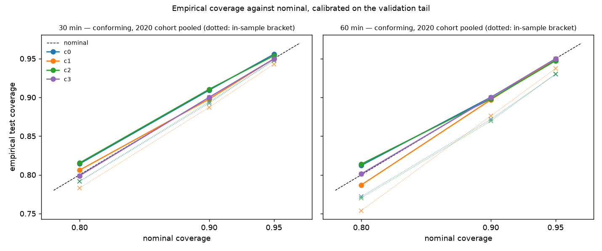
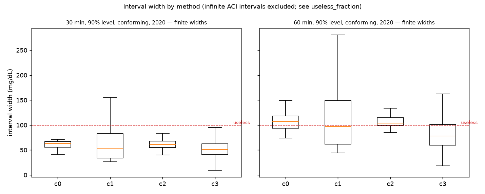
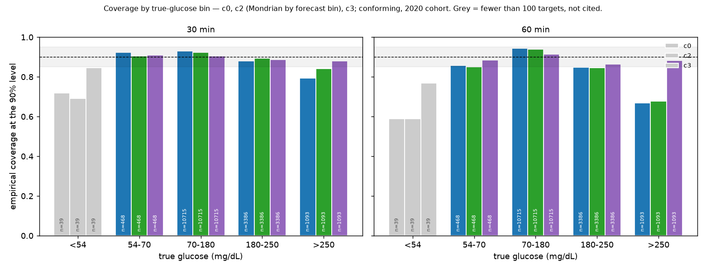
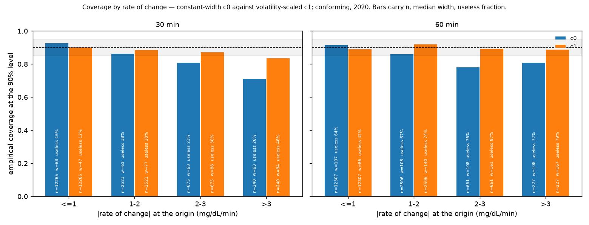
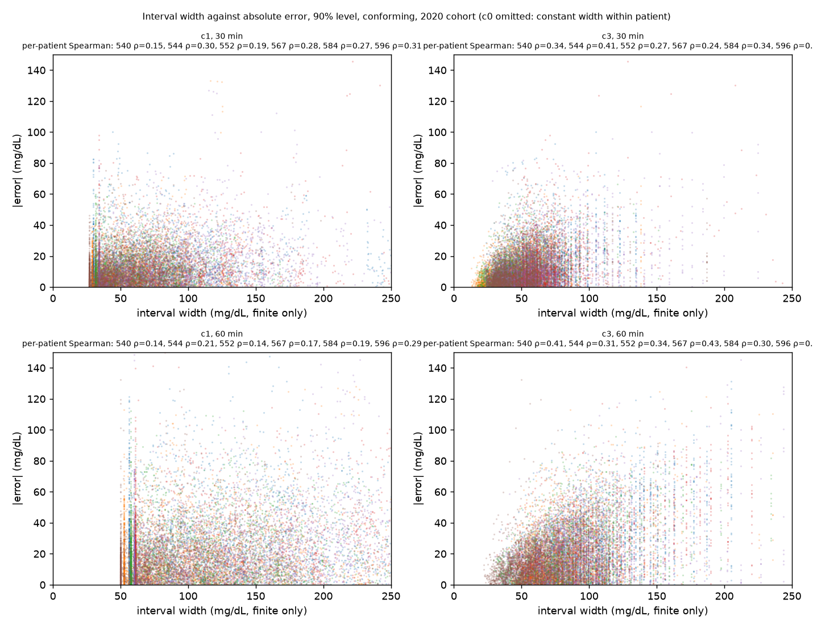
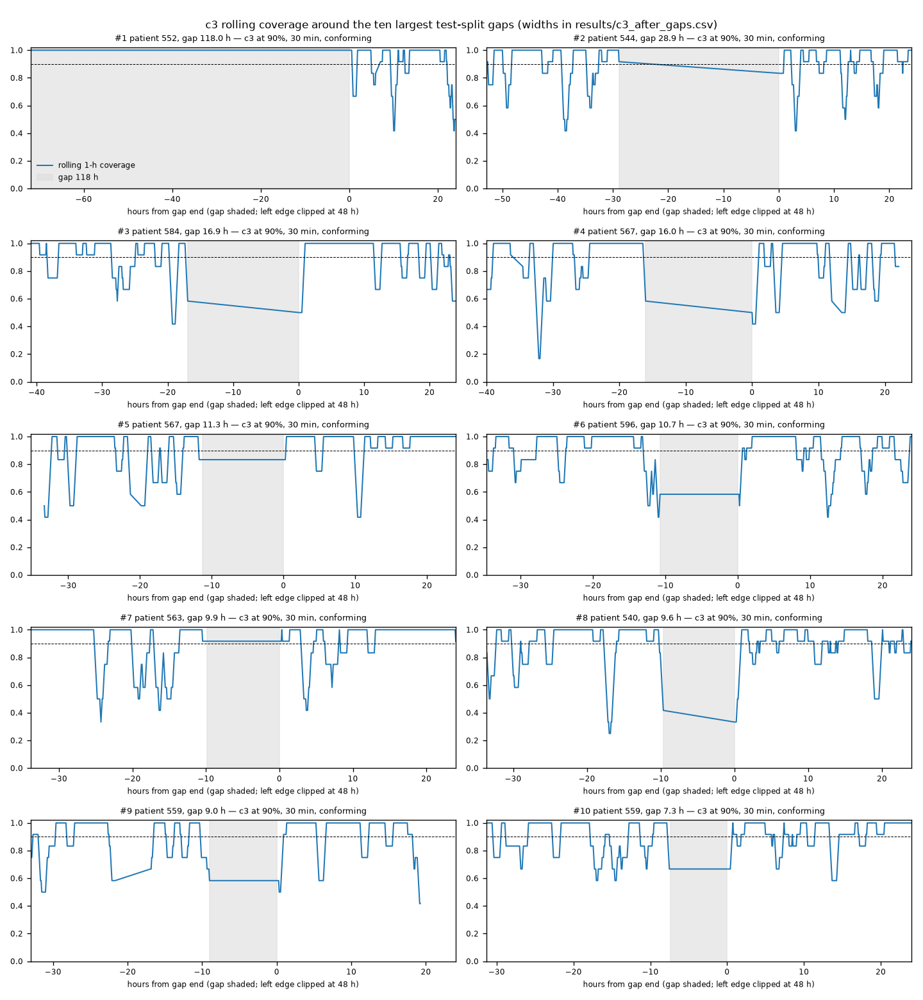

# cgm-forecast-conformal

Glucose forecasting at 30 and 60 minutes with calibrated conformal prediction intervals, evaluated by clinical error grids rather than RMSE alone.

**Result.** Under the Blood Glucose Level Prediction Challenge's own rules — every post-outage test point predicted, no interpolation, nothing after the forecast origin, 2020 cohort, mean of six — the final sequence model scores **19.53 / 32.43 mg/dL RMSE at 30 / 60 minutes**, four-score sum **88.96**, which places it **5th of nine** against the eight officially ranked systems — behind Rubin-Falcone (86.31), Hameed (87.15), Zhu (88.12) and Yang (88.41), ahead of Bevan (89.45). It beats the linear autoregression with the same inputs by **+1.24 [0.76, 1.71] mg/dL at 30 minutes and +1.69 [1.36, 2.06] at 60** (paired over the six patients, bootstrap over patients, 6 of 6 improved), and persistence by +5.95 / +8.98. It does not reach the published best with matching inputs: Zhu 18.34 / 32.21 and Rubin-Falcone 18.22 / 31.66 are 1.2–1.3 mg/dL ahead at 30 minutes and 0.2–0.8 at 60. **The staircase below shows where each mg/dL came from**: a single-configuration GRU with the same inputs as the linear autoregression does not meaningfully beat it (20.57); full-horizon training, ensembling over history lengths and pre-training on the other patients bought the rest. **And the model that wins on RMSE detects hypoglycaemia worst**: sensitivity at 70 mg/dL an hour ahead is 0.012, against persistence's 0.353. Under this repository's primary protocol the same model scores 17.64 / 30.82 on the 2020 cohort (all twelve patients, conforming: 19.07 / 31.19); every method is reported under both rules. **Intervals (Week 5, first pass): split conformal is on nominal pooled (0.909 / 0.900 at 90%) but a 90% interval an hour ahead is 107 mg/dL wide; the point forecast detects 7% of hypoglycaemia onsets at 30 minutes and the 90% lower bound detects 90% by alarming 41 times a day.** The operating curve across levels is Saturday's; the evaluation protocol was frozen before anything was fitted ([docs/protocol.md](docs/protocol.md)).

## The data layer

12 patients, two cohorts of six, eight weeks each, CGM every five minutes. **Every patient reconciles exactly with Table 2 of the dataset paper**: all 12 training counts match, the 2018 test files match their published counts, and every 2020 test file carries exactly 12 more readings — the first hour, which the 2020 challenge excludes from evaluation and which this repository therefore excludes too.

The cohorts do not share a sensor-band channel set. The 2018 cohort wore the Basis Peak and has heart rate, GSR, skin temperature, air temperature and steps at a 5-minute aggregation; the 2020 cohort wore the Empatica Embrace and has GSR, skin temperature and acceleration at a 1-minute aggregation. The absent channels are represented inconsistently — present-but-empty for five 2020 patients, absent entirely for 596 — so the loader treats missing and empty alike and asserts the difference in both directions.

**Gaps are the thing that would corrupt this silently** (`results/gap_analysis.csv`). The CGM series is **11.9% incomplete on average in training and 10.7% in test**; the worst patient/split, 552/test, is **40.2% missing**; and the longest single gap is **118 hours**. Cut naively, 1.6% of 30-minute history windows cross a gap, 3.4% of 1-hour windows and **7.1% of 2-hour windows** — 13.9% for the worst patient. The frozen rule: history may be interpolated across at most 30 minutes, longer gaps drop the window, and **a target is never interpolated** — a forecast is scored only against a real CGM reading.

**Windows are built on that rule** (`src/data/windows.py`, D-013 to D-016). One window per real reading with enough history; history slots sit at exactly 30 or 60 minutes before the target and are valued by interpolation in time, because the cadence is not exactly 300 s (503 of 166,000 intervals are 301–360 s). Covariates the primary models may use — basal with temporary overrides, boluses with extended ones spread over their delivery, carbohydrates — are aligned to the same slots and see nothing after the history end. **`results/effective_n.csv` is the n column that accompanies every result from here on**: 92–97% of raw readings are evaluable depending on horizon and history length, and 552's test split, 40% missing, keeps 89% of its own readings but only **53% of the readings its sensor should have produced**. Reconciling the windower against the naive gap count found that index-space windows miss every target whose latest reading is older than it looks — the true cost of gaps at 30 minutes is about twice the naive figure (D-016).


*Clarke error grid, 30-minute forecasts, conforming evaluation, 2020 cohort pooled (n = 15,701): persistence on the left, the final model on the right. The model moves 8.3 points of forecasts from zone B into zone A; zones A+B are 98.6% for persistence and 98.4% for the model — the grid barely separates them, which is why hypoglycaemia sensitivity is reported beside it. Parkes grid in [figures/parkes_final.png](figures/parkes_final.png).*

## The sequence model, built as a staircase

**A sequence model with the same inputs as a linear autoregression does not beat it until it is trained on the full horizon, ensembled over history lengths and pre-trained on the other patients; those steps were worth 0.25, 0.25 and 0.34 mg/dL respectively at 30 minutes (conforming, 2020), the choice of family a further 0.12 and the ensemble of the final model 0.40, of which pre-training and both ensembles exceeded seed variability (0.15) and configuration selection (-0.01) and the family choice did not.** At 60 minutes the full-horizon loss alone was worth 1.36.

Every step keeps what the step before chose; every choice is made on the frozen validation tail (D-025), never on test; every step is scored under both evaluation variants on every patient (`results/sequence_steps.csv`, `results/sequence_per_patient.csv`, `results/sequence_paired.csv`, seeds mean ± SD). Inputs are frozen at CGM history plus basal (with temporary overrides), boluses (spread over delivery) and carbohydrates — no wearable channels, no finger-stick, no time of day (D-032).

| Step | Conforming 30 min | Conforming 60 min | Primary 30 min | Primary 60 min | Four-score (conforming) | Position |
|---|---|---|---|---|---|---|
| Step 1 — single configuration: GRU 64, 1 layer, dropout 0.2, H = 24, 3 seeds | 20.57 ± 0.15 | 34.17 ± 0.03 | 18.79 ± 0.05 | 33.01 ± 0.08 | 94.50 | 8 of 9 |
| Step 2 — validation-selected configuration (coordinate search, 1 seed) | 20.58 | 34.84 | 18.70 | 33.19 | 95.74 | 8 of 9 |
| Step 3 — full-horizon loss, kept where it won on validation (1 seed) | 20.33 | 33.49 | 18.45 | 31.90 | 92.75 | 7 of 9 |
| Step 4 — chosen configuration, 5 seeds | 20.39 ± 0.15 | 34.07 ± 0.21 | 18.56 ± 0.10 | 32.45 ± 0.15 | 93.86 | 7 of 9 |
| Step 4e — history-length ensemble, median over H ∈ {12…42} | 20.13 | 33.66 | 18.32 | 32.10 | 92.75 | 7 of 9 |
| Step 5 — pre-trained on the twelve training files + 2018 test files, fine-tuned per patient, 5 seeds | 20.05 ± 0.14 | 33.29 ± 0.52 | 18.21 ± 0.09 | 31.59 ± 0.54 | 91.48 | 7 of 9 |
| Step 5p — population model alone, leave-one-patient-out (1 seed) | 20.59 | 34.94 | 18.90 | 33.56 | 95.75 | 8 of 9 |
| Step 6 — dilated causal CNN, validation-selected, 5 seeds | 20.35 ± 0.12 | 33.76 ± 0.20 | 18.67 ± 0.08 | 32.55 ± 0.20 | 93.28 | 7 of 9 |
| Step 6e — TCN history-length ensemble | 20.12 | 33.27 | 18.35 | 31.83 | 91.90 | 7 of 9 |
| Step 7 — final model: per patient the family that won on validation, pre-trained and fine-tuned, 5 seeds | 19.93 ± 0.12 | 33.42 ± 0.21 | 18.18 ± 0.07 | 31.91 ± 0.18 | 91.44 | 7 of 9 |
| **Step 7e — final model, history-length ensemble (frozen)** | **19.53** | **32.43** | 17.64 | 30.82 | 88.96 | 5 of 9 |
| Step 7a — final configuration without covariates, 5 seeds | 20.85 ± 0.06 | 34.96 ± 0.29 | 19.12 ± 0.07 | 33.62 ± 0.30 | 95.86 | 9 of 9 |

*2020 cohort, mean of six patients, RMSE in mg/dL; ± is the SD over seeds where more than one seed ran. Position is in the official BGLP 2020 ranking of eight systems plus this one (`results/sequence_ranking.csv`). Linear AR for reference: 20.77 / 34.12 conforming, 18.61 / 32.37 primary.*

**Did the networks learn beyond their persistence initialisation?** Every model starts exactly at persistence (zero-initialised change head), so a fit whose best validation epoch is 1 has learned one epoch's worth. In Steps 1–4 they did learn: the median best epoch in Step 1 is 22, and 64 of 72 fits improved past epoch 1. The epoch-1 stops in those steps are **50 fits, 49 of them for two patients — 591 (28) and 570 (21), plus one for 588** — whose validation tails rise from the first epoch; per-patient early stopping on those two splits is a limitation, and the split is frozen and not changed. **The fine-tuning steps are different**: in Step 7, 74 of 120 fine-tunes and 78 of 120 ensemble fine-tunes stopped at epoch 1 (62 of 120 in Step 5), while the pre-trained population models they start from peaked around epoch 6. Fine-tuning from pre-trained weights barely moved on validation. **So the final model is, in practice, a population model trained on all twelve training files and the 2018 test files — the patient's own training file included — with one epoch of patient adaptation, ensembled over history lengths.** That is Bevan's all-patients scheme (18.23 / 31.10), not Rubin-Falcone's per-patient fine-tuning, and the comparison is drawn accordingly. The leave-one-patient-out population model, which has never seen the evaluated patient, scores 20.59; the "fine-tuned" one 20.05: most of that 0.54 is having seen the patient's training data, not the fine-tuning epochs. The fine-tuner was never offered zero epochs — the pre-trained state itself was not a candidate — which is a limitation of the harness, listed below. Full distribution: `results/best_epochs.csv`, [figures/best_epochs.png](figures/best_epochs.png).

**Step 1, stated plainly.** A paired gain of +0.36 [0.01, 0.67], 5 of 6 at 30 minutes, with nothing at 60 and −0.03 [−0.32, 0.27] under the primary variant, is marginal, not a gain: *a single-configuration GRU with the same inputs as the linear autoregression does not meaningfully beat it.* The pre-registered expectation of 18.5–19.5 for this model (D-030) was not met; the check was recorded before any later step ran (D-034).

**The second family.** A dilated causal CNN, searched with the same discipline, won on validation for 9 of 24 patient-horizons and is the final family for those; its own ensemble scored 20.12 / 33.27, within seed variability of the recurrent one.

**Per patient, conforming, with the fallback count beside the penalty** — does the model lose on 567 and 584 the way the linear AR did? Yes, by almost the same amount:

| Patient | n | Fallback 30 / 60 | Final, primary → conforming, 30 min | penalty | Final, primary → conforming, 60 min | Linear AR penalty, 30 min |
|---|---|---|---|---|---|---|
| 540 | 2,884 | 145 / 164 | 19.35 → **20.92** | +1.57 | 36.38 → 38.08 | +1.42 |
| 544 | 2,704 | 87 / 105 | 15.94 → **16.60** | +0.66 | 26.76 → 27.28 | +0.46 |
| 552 | 2,352 | 210 / 252 | 15.17 → **15.58** | +0.41 | 28.27 → 28.94 | +0.82 |
| 567 | 2,377 | 261 / 315 | 19.22 → **23.53** | +4.31 | 33.83 → 37.98 | +5.44 |
| 584 | 2,653 | 348 / 391 | 20.34 → **24.78** | +4.44 | 33.50 → 36.32 | +4.39 |
| 596 | 2,731 | 174 / 204 | 15.84 → **15.80** | -0.04 | 26.18 → 25.99 | +0.42 |

*Final model (7e). The linear AR's conforming penalties at 30 minutes were +5.44 (567) and +4.39 (584); the model's are +4.31 and +4.44. The primary-to-conforming gap for the model is 1.89 mg/dL at 30 minutes against the linear AR's 2.16: the cost of the outages is paid by every method alike. 596 is the one patient marginally easier under the conforming rule (-0.04); the cohort-level check that conforming is never easier passed.*

**Covariate ablation.** The final configuration without insulin and meals scores 20.85 ± 0.06 / 34.96 ± 0.29 against 19.93 / 33.42 with them: **the covariates are worth -0.92 mg/dL at 30 minutes and -1.54 at 60** to the sequence model — the same ~0.9 they were worth to the linear model — and without them the sequence model does not beat the linear AR that has them (+0.11 [-0.41, 0.67], 3 of 6).

**Clinical scoring of the final model** (`results/clinical_final.csv`; frozen scorer, D-022–024):

| Method (conforming, 2020 pooled) | h | n | Clarke A / A+B | Parkes A / A+B | MARD | TIR agreement | Sens 70 (events) | Sens 54 (events, at floor) |
|---|---|---|---|---|---|---|---|---|
| persistence | 30 | 15,701 | 80.7 / 98.6 | 83.0 / 99.4 | 12.5% | 0.867 | **0.546** (507) | 0.051 (39, 2) |
| persistence | 60 | 15,701 | 60.2 / 96.1 | 63.4 / 96.9 | 21.2% | 0.780 | **0.353** (507) | 0.000 (39, 2) |
| linear AR H=24 +cov | 30 | 15,701 | 86.3 / 97.9 | 89.8 / 99.6 | 10.6% | 0.887 | **0.233** (507) | 0.051 (39, 2) |
| linear AR H=24 +cov | 60 | 15,701 | 64.8 / 95.5 | 69.6 / 97.5 | 18.7% | 0.818 | **0.047** (507) | 0.000 (39, 2) |
| **final model (7e)** | 30 | 15,701 | 88.9 / 98.4 | 90.7 / 99.5 | 9.6% | 0.899 | **0.318** (507) | 0.000 (39, 2) |
| **final model (7e)** | 60 | 15,701 | 70.2 / 95.9 | 73.3 / 97.8 | 16.9% | 0.832 | **0.012** (507) | 0.000 (39, 2) |

The error grids separate the three methods by a few points of zone A and not at all on A+B. **Hypoglycaemia sensitivity separates them the other way**: at 30 minutes the model detects 31.8% of reference readings below 70 mg/dL, the linear AR 23.3%, persistence 54.6%; at 60 minutes the model detects **1.2%** against persistence's 35.3%, and at 54 mg/dL it detects none. A model trained on squared error forecasts the conditional mean, and the conditional mean an hour ahead is almost never below 70. Zhu's reported worst case of 8% of 60-minute forecasts in Clarke zone D is not exceeded here — the worst patient is 567 at 7.7% — but the over-prediction-into-hypoglycaemia failure Zhu describes appears as its mirror: the model under-reads the lows. The 54 mg/dL figures rest on 39 events across the cohort, 2 at the sensor floor, and are flagged as censored in the file.

**Not done, and logged as not done (D-038):** no hyperparameter chosen on test; no external data; no test-time adaptation; no wearable inputs; no finger-stick or time-of-day inputs. The remaining gap to Rubin-Falcone is, on the honest reading, attributable to its ~15M steps of external pre-training (Tidepool) and its two extra inputs; the gap to Zhu (1.2 at 30 minutes, 0.2 at 60) is not explained by inputs and belongs to this implementation.

## Week 5 — intervals around the frozen model (first pass, 12 Oct)

The model is frozen at `75e0817`; nothing here retrains, re-selects or refits it. Conformal prediction wraps it. **Calibration set:** the frozen 20% validation tail of each training file — which early stopping consumed, so its residuals are mildly optimistic. Rather than argue about the contamination, it is measured: empirical test coverage against nominal, with an **in-sample bracket** (calibration on the fit portion's residuals, known optimistic) beside it. The frozen model's predictions on its training file came from regenerating all 144 ensemble members from their recorded seeds and starting weights and asserting, member by member, that the regenerated test predictions equal the cached ones to the last bit (D-045). Four methods, none retraining (D-046): split conformal (c0), residuals scaled by the volatility of the history strictly before the forecast origin (c1), Mondrian by forecast bin — below 70, 70–180, above 180 (c2), and adaptive conformal inference, online (c3). Conformalised quantile regression is excluded: the model is a frozen point forecaster.



| Method | h | 80% coverage (bracket) | 90% coverage (bracket) | 95% coverage (bracket) | 90% median width | 90% useless |
|---|---|---|---|---|---|---|
| c0 split conformal | 30 | 0.814 (0.791) | 0.909 (0.893) | 0.956 (0.949) | 63 mg/dL | 16.9% |
| c1 scaled by history volatility | 30 | 0.806 (0.783) | 0.898 (0.887) | 0.950 (0.943) | 56 mg/dL | 16.4% |
| c2 Mondrian by forecast bin | 30 | 0.815 (0.792) | 0.910 (0.894) | 0.954 (0.947) | 61 mg/dL | 16.9% |
| c3 adaptive (online) | 30 | 0.799 (0.799) | 0.900 (0.900) | 0.950 (0.950) | 51 mg/dL | 5.6% |
| c0 split conformal | 60 | 0.812 (0.772) | 0.900 (0.872) | 0.948 (0.930) | 107 mg/dL | 65.4% |
| c1 scaled by history volatility | 60 | 0.787 (0.754) | 0.897 (0.876) | 0.950 (0.937) | 99 mg/dL | 49.6% |
| c2 Mondrian by forecast bin | 60 | 0.814 (0.770) | 0.898 (0.869) | 0.947 (0.930) | 104 mg/dL | 57.9% |
| c3 adaptive (online) | 60 | 0.801 (0.801) | 0.900 (0.900) | 0.950 (0.950) | 85 mg/dL | 30.5% |

*Conforming evaluation, 2020 cohort pooled over points (n = 15,701 at 30 min, 15,701 at 60). Bracket = the same method calibrated on the fit portion. "Useless" = width over 100 mg/dL or infinite. Every patient, both variants, all levels: `results/coverage.csv`.*

**What the first pass says.** Pooled, split conformal is on nominal: **0.909 / 0.900 at the 90% level** against the in-sample bracket's 0.893 / 0.872 — the validation tail's contamination by early stopping cost almost nothing at 30 minutes and about three points at 60, which the bracket shows and the validation calibration removes. **But a 90% interval an hour ahead is 107 mg/dL wide at the median and 65% of them are wider than 100**: the honest 60-minute interval is mostly too wide to act on. The adaptive method narrows that to 85 with 31% useless, at the cost of some infinite intervals after outages. **The stop condition fired on two patient sets** (c0 at 90% more than five points under nominal): 596 at 30 minutes (0.846) and 540 at 60 (0.842). For 596 the in-sample bracket covers *better* (0.912) — its test residuals are simply larger than its training residuals, an exchangeability failure, not an early-stopping artefact. c3 restores both to nominal (0.901 at 44 mg/dL; 0.899 at 93 mg/dL, 45% useless), which is what it is for (D-048).



**Hypoglycaemia onset detection, defined correctly** (D-047). Week 4's sensitivity counted every target below 70 mg/dL, including those already below it at the forecast origin — which persistence "detects" for free, so its 0.353 was not a detection rate. An **onset** is a target below the threshold whose origin reading was at or above it; persistence's onset sensitivity is zero by construction. Reported with specificity, PPV and false alarms per day, never alone:

| Detector (conforming, 2020 pooled) | h | Onsets | Sensitivity | Specificity | PPV | False alarms / day |
|---|---|---|---|---|---|---|
| persistence (zero by construction) | 30 | 230 | 0.000 | 1.000 | — | 0.00 |
| linear AR, point forecast | 30 | 230 | 0.083 | 0.998 | 0.396 | 0.55 |
| final model, point forecast | 30 | 230 | 0.070 | 0.999 | 0.432 | 0.40 |
| **c0 lower bound at 90%** | 30 | 230 | 0.904 | 0.855 | 0.087 | 41.15 |
| persistence (zero by construction) | 60 | 328 | 0.000 | 1.000 | — | 0.00 |
| linear AR, point forecast | 60 | 328 | 0.012 | 0.998 | 0.121 | 0.55 |
| final model, point forecast | 60 | 328 | 0.000 | 0.999 | 0.000 | 0.19 |
| **c0 lower bound at 90%** | 60 | 328 | 0.875 | 0.719 | 0.064 | 79.28 |

*Conforming, 2020 cohort, 70 mg/dL, 90% level for the lower bound; the at-risk set is every target whose origin reading was ≥ 70. At 54 mg/dL: 37 onsets at 30 minutes, the point forecast detects 0, 2 at the sensor floor. `results/onset_first_pass.csv`.*

**The point forecast detects 7.0% of 30-minute onsets and 0.0% of 60-minute ones.** The 90% lower bound detects 90.4% and 87.5% — by alarming on **41 and 79 non-events per day**, with a positive predictive value of 0.09 and 0.06. At this level the lower bound is not an alarm; it is the bottom of a wide interval. Whether any level or method sits on a usable point of the sensitivity–false-alarm trade-off is Saturday's operating curve, which is now the figure this repository is building toward.

## Where coverage breaks

Pooled, every method is on nominal at the 90% level (c0 0.909, c1 0.898, c2 0.910, c3 0.900 at 30 minutes, conforming, 2020 — the Week 5 first pass above); this section is where it stops being. The rules for calling a cell a finding were logged before the tables were read (D-053): **n ≥ 100** or the cell is greyed and never cited; **more than 5 points from nominal at 90% in both evaluation variants**, or it is "variant-specific", not a finding; true-glucose bin at 90%, conforming, 2020 is the headline stratification; and every miss is split into *below* the lower bound (the lower bound too high — the dangerous direction for a hypoglycaemia target) and *above* the upper bound. All 2,304 cells are in `results/coverage_breakdown.csv`; the prose cites by the rule.



| Method | h | <54 | 54-70 | 70-180 | 180-250 | >250 |
|---|---|---|---|---|---|---|
| c0 split conformal | 30 | — (n = 39) | 0.923 · 100% below · n 468 · 63 mg/dL · within 5 | 0.930 · 55% below · n 10,715 · 63 mg/dL · within 5 | 0.880 · 19% below · n 3,386 · 63 mg/dL · within 5 | 0.793 · 8% below · n 1,093 · 63 mg/dL · **finding** |
| c2 Mondrian, by **true** bin | 30 | — (n = 39) | 0.906 · 100% below · n 468 · 59 mg/dL · within 5 | 0.924 · 51% below · n 10,715 · 59 mg/dL · within 5 | 0.893 · 15% below · n 3,386 · 67 mg/dL · within 5 | 0.841 · 5% below · n 1,093 · 67 mg/dL · **finding** |
| c2 Mondrian, by **forecast** bin (what it guarantees) | 30 | — (n = 3) | 0.868 · 16% below · n 242 · 41 mg/dL · within 5 | 0.911 · 36% below · n 11,097 · 59 mg/dL · within 5 | 0.921 · 45% below · n 3,411 · 67 mg/dL · within 5 | 0.883 · 45% below · n 948 · 67 mg/dL · within 5 |
| c3 adaptive | 30 | — (n = 39) | 0.910 · 100% below · n 468 · 56 mg/dL · within 5 | 0.906 · 54% below · n 10,715 · 49 mg/dL · within 5 | 0.887 · 23% below · n 3,386 · 55 mg/dL · within 5 | 0.881 · 13% below · n 1,093 · 71 mg/dL · within 5 |
| c0 split conformal | 60 | — (n = 39) | 0.857 · 100% below · n 468 · 108 mg/dL · within 5 | 0.943 · 68% below · n 10,715 · 107 mg/dL · within 5 | 0.848 · 12% below · n 3,386 · 108 mg/dL · **finding** | 0.668 · 0% below · n 1,093 · 108 mg/dL · **finding** |
| c2 Mondrian, by **true** bin | 60 | — (n = 39) | 0.850 · 100% below · n 468 · 108 mg/dL · within 5 | 0.940 · 65% below · n 10,715 · 99 mg/dL · within 5 | 0.846 · 8% below · n 3,386 · 109 mg/dL · **finding** | 0.678 · 1% below · n 1,093 · 109 mg/dL · **finding** |
| c2 Mondrian, by **forecast** bin (what it guarantees) | 60 | — (n = 0) | — (n = 28) | 0.907 · 29% below · n 11,549 · 99 mg/dL · within 5 | 0.885 · 43% below · n 3,440 · 109 mg/dL · within 5 | 0.822 · 57% below · n 684 · 115 mg/dL · **finding** |
| c3 adaptive | 60 | — (n = 39) | 0.885 · 100% below · n 468 · 77 mg/dL · within 5 | 0.914 · 59% below · n 10,715 · 77 mg/dL · within 5 | 0.864 · 13% below · n 3,386 · 88 mg/dL · within 5 | 0.883 · 7% below · n 1,093 · 121 mg/dL · within 5 |

*Each cell: coverage · share of misses that are below the lower bound · n · median width · verdict under D-053. Conforming evaluation, 2020 cohort, 90% level. The < 54 bin has 39 targets and is not cited.*

**By true glucose, the expectation did not come true where it was expected and came true where it was not.** The constant-width c0 was expected to under-cover below 70 with the misses below. In the 54–70 bin (n = 468) it covers **0.923 at 30 minutes and 0.857 at 60** — within the 5-point rule at both horizons, so *not a finding* — and every miss it does make there is below the lower bound (36 of 36 misses at 30 minutes, 67 of 67 at 60): when the interval fails on a low reading, it fails in the dangerous direction, every time. **The finding under the rule is at the top of the range:** above 250 mg/dL (n = 1,093) c0 covers **0.793 at 30 minutes and 0.668 at 60**, and 180–250 at 60 minutes 0.848 — in both variants, with the misses *above* the upper bound (100% of them at 60 minutes). The model shrinks toward the mean at the top of the range as much as at the bottom, and a constant-width interval cannot follow it there. **c3 holds nominal in every reportable bin** (0.881 / 0.883 above 250) by widening online — its median width above 250 at 60 minutes is 121 mg/dL.

**c2, both ways.** Mondrian by forecast bin guarantees coverage per *forecast* bin, which is not the bin a clinician asks about. By forecast bin it holds within the rule at 30 minutes everywhere reportable and fails above 250 at 60 minutes (0.822, n = 684); by *true* bin it fails above 250 at both horizons (0.841 / 0.678) and 180–250 at 60. In the 54–70 true bin it covers 0.906 / 0.850 — within the rule. The forecast bin below 70 is nearly empty (242 forecasts at 30 minutes, 28 at 60): **the model almost never forecasts below 70, which is why conditioning on its forecast cannot protect the readings that end up there.** That is a statement about the model's bias (Week 4's sensitivity result), not about conformal.



**Rate of change: fast-moving glucose breaks the constant-width methods, and c1 fixes it at a price.**

| Rate at origin (mg/dL/min) | n (30 / 60) | c0 coverage 30 / 60 | c1 coverage 30 / 60 | c1 median width 30 / 60 | c1 useless 30 / 60 |
|---|---|---|---|---|---|
| <=1 | 12,265 / 12,307 | 0.928 (within 5) / 0.916 (within 5) | 0.903 (within 5) / 0.892 (within 5) | 47 / 86 | 12% / 42% |
| 1-2 | 2,521 / 2,506 | 0.864 (variant-specific) / 0.863 (variant-specific) | 0.887 (within 5) / 0.921 (within 5) | 77 / 140 | 28% / 74% |
| 2-3 | 675 / 661 | 0.809 (**finding**) / 0.782 (**finding**) | 0.874 (within 5) / 0.894 (within 5) | 88 / 161 | 36% / 87% |
| >3 | 240 / 227 | 0.713 (**finding**) / 0.811 (**finding**) | 0.838 (**finding**) / 0.890 (within 5) | 94 / 167 | 46% / 79% |

c0 falls to 0.809 / 0.782 at 2–3 mg/dL/min and 0.713 / 0.811 above 3 — findings in both variants. c1's volatility-scaled width brings every one of those cells back within the rule except above 3 mg/dL/min at 30 minutes (0.838), **and it does so with intervals of 94 / 167 mg/dL at the median, 46% / 79% of them wider than 100.** On fast-moving glucose c1 holds coverage largely by saying it does not know.



**Width against error: does the uncertainty inform?** c0's width is constant within a patient, so its within-patient correlation is zero by construction; across the six patients the correlation between a patient's c0 width and its RMSE is 0.66 at 30 minutes and 0.83 at 60 — the patient with the wider interval is the patient with the larger errors. Within patient, **c3's width correlates with the error at a Spearman median of 0.34 (range 0.24–0.41) at 30 minutes and 0.36 at 60; c1's at 0.28 and 0.18; c2's at 0.08 and 0.09.** The online method's intervals are wide where the errors are; the volatility-scaled ones less so; Mondrian's barely at all.



**Recovery after outages.** For the ten largest test-file gaps, 552's 118 hours first, the minutes after the gap closes until c3's rolling one-hour coverage is back within 5 points of nominal:

| # | Patient | Gap (h) | Minutes to recover, 30 / 60 min | Infinite share, first hour, 30 / 60 | Median finite width, first hour, 30 / 60 |
|---|---|---|---|---|---|
| 1 | 552 | 118.0 | 0.0 / 0.0 | 0% / 0% | 47.3 / 76.5 |
| 2 | 544 | 28.9 | 55.0 / 0.0 | 0% / 0% | 43.4 / 64.5 |
| 3 | 584 | 16.9 | 55.0 / 45.0 | 54% / 54% | 92.0 / 269.2 |
| 4 | 567 | 16.0 | 60.0 / 70.0 | 0% / 15% | 68.2 / 101.1 |
| 5 | 567 | 11.3 | 20.0 / 0.0 | 0% / 0% | 140.3 / 140.6 |
| 6 | 596 | 10.7 | 40.0 / 45.0 | 0% / 0% | 71.5 / 80.1 |
| 7 | 563 | 9.9 | 0.0 / 0.0 | 0% / 0% | 55.5 / 51.9 |
| 8 | 540 | 9.6 | 55.0 / 65.0 | 38% / 23% | 66.5 / 94.5 |
| 9 | 559 | 9.0 | 55.0 / 40.0 | 54% / 69% | 68.7 / 248.4 |
| 10 | 559 | 7.4 | 40.0 / 40.0 | 8% / 0% | 99.2 / 115.5 |

*`results/c3_recovery.csv`; "0" means the first hour after the gap was already within 5 points. Widths in mg/dL.*

Every gap recovered within the 24 hours examined; the median is **48 minutes at 30 minutes and 40 at 60**, the longest 60 / 70. After 552's 118-hour gap c3 was within 5 points from the first hour with no infinite intervals and a median width of 47.3 / 76.5 mg/dL. On 4 of the ten gaps at 30 minutes (4 at 60) the first hour contained infinite intervals, up to 54% / 69% of its targets. **For a deployed system: a user coming back from a sensor outage gets intervals that track nominal coverage again within about an hour, and in that hour they are 43–140 mg/dL wide at 30 minutes, 52–269 at 60, with no finite bound at all on some readings after some outages.**

**What this does not show.** Cells with fewer than 100 targets — the whole < 54 mg/dL bin (39 targets at 90%), the forecast bins below 70 — are in the CSV and greyed in the figures, and nothing is claimed from them; the level-2 hypoglycaemia question is answered on Saturday by the onset metric, not by a coverage cell. Mondrian c2 conditions on the forecast bin and is reported by the true bin as well because the two are different questions; a method conditioned on the *true* bin would condition on the target and is not permitted (D-053). None of this is a claim about sensor accuracy: the reference is a CGM, every interval is an interval around agreement with a device ([Limitations](#limitations-and-failure-cases)). The iCGM analogues are not computed: the criteria have not yet been transcribed from the regulation (D-058).

## Baselines

Written before any sequence model exists. Test split only, scored targets only (D-017), RMSE and MAE in mg/dL as mean of per-patient values with the pooled figure in brackets, MAPE beside them, and the number of real targets under every figure. Per-patient figures, including those for each cohort, are in `results/baselines_per_patient.csv`; the cohort rows are in `results/baselines.csv`.

**The persistence floor is 23.4 mg/dL RMSE at 30 minutes and 38.5 at 60** — the error of forecasting the most recent reading, which every other method also sees. That is the floor every later method is measured from: the linear AR beats it by 4.4 and 6.6 mg/dL here, and the final sequence model by 5.9 and 9.0 under the conforming rules on the 2020 cohort.

| Baseline | Fit | H | 30 min RMSE (pooled) | MAE | MAPE | n | SD / worst | 60 min RMSE (pooled) | MAE | MAPE | n | SD / worst | Published |
|---|---|---|---|---|---|---|---|---|---|---|---|---|---|
| **p0** persistence | none | 6 | **23.39** (23.55) | 17.01 | 11.4% | 30,912 | 2.88 / 540 28.4 | **38.54** (38.79) | 28.70 | 19.4% | 30,579 | 4.73 / 540 47.5 | — |
| l1 extrapolation, k=2 | none | 6 | 29.86 (30.33) | 19.14 | 12.8% | 30,912 | 5.33 / 575 39.9 | 63.35 (64.07) | 41.93 | 28.2% | 30,579 | 9.52 / 575 80.3 | — |
| l1 extrapolation, k=3 | none | 6 | 28.23 (28.61) | 18.58 | 12.4% | 30,912 | 4.74 / 575 37.9 | 59.12 (59.72) | 40.11 | 27.0% | 30,579 | 8.57 / 575 74.4 | — |
| l1 extrapolation, k=6 | none | 6 | 28.15 (28.43) | 19.12 | 12.8% | 30,912 | 4.17 / 575 35.7 | 55.86 (56.37) | 39.02 | 26.4% | 30,579 | 8.02 / 540 66.8 | — |
| l2 linear AR | per-patient | 6 | 19.95 (20.09) | 14.33 | 9.8% | 30,912 | 2.39 / 575 24.4 | 33.89 (34.09) | 25.55 | 17.9% | 30,579 | 3.85 / 540 41.2 | — |
| l2 linear AR + covariates | per-patient | 6 | 19.42 (19.56) | 13.91 | 9.5% | 30,912 | 2.42 / 575 23.9 | 32.72 (32.90) | 24.57 | 17.2% | 30,579 | 3.77 / 540 39.4 | — |
| l2 linear AR | population, LOPO | 6 | 20.10 (20.23) | 14.48 | 9.9% | 30,912 | 2.27 / 575 23.9 | 34.20 (34.37) | 25.88 | 18.1% | 30,579 | 3.56 / 540 40.8 | — |
| l2 linear AR + covariates | population, LOPO | 6 | 19.79 (19.92) | 14.27 | 9.8% | 30,912 | 2.29 / 575 23.5 | 33.63 (33.78) | 25.46 | 17.8% | 30,579 | 3.42 / 540 40.3 | — |
| l2 linear AR | per-patient | 12 | 19.94 (20.09) | 14.30 | 9.8% | 30,501 | 2.42 / 575 24.4 | 33.89 (34.09) | 25.52 | 17.8% | 30,170 | 3.94 / 540 41.2 | — |
| l2 linear AR + covariates | per-patient | 12 | 19.09 (19.23) | 13.60 | 9.3% | 30,501 | 2.43 / 575 23.6 | 32.23 (32.41) | 24.10 | 16.8% | 30,170 | 3.70 / 540 38.9 | — |
| l2 linear AR | population, LOPO | 12 | 20.11 (20.23) | 14.47 | 9.9% | 30,501 | 2.30 / 575 23.9 | 34.20 (34.35) | 25.86 | 18.0% | 30,170 | 3.63 / 540 40.9 | — |
| l2 linear AR + covariates | population, LOPO | 12 | 19.61 (19.73) | 14.08 | 9.6% | 30,501 | 2.27 / 575 23.3 | 33.36 (33.51) | 25.18 | 17.6% | 30,170 | 3.26 / 540 40.0 | — |
| l2 linear AR | per-patient | 24 | 19.94 (20.09) | 14.30 | 9.8% | 29,678 | 2.50 / 575 24.7 | 33.78 (33.97) | 25.43 | 17.7% | 29,342 | 3.99 / 540 41.0 | — |
| l2 linear AR + covariates | per-patient | 24 | 19.02 (19.17) | 13.51 | 9.2% | 29,678 | 2.46 / 575 23.6 | 31.97 (32.18) | 23.83 | 16.5% | 29,342 | 3.79 / 540 38.9 | — |
| l2 linear AR | population, LOPO | 24 | 20.10 (20.23) | 14.45 | 9.9% | 29,678 | 2.38 / 575 24.0 | 34.09 (34.23) | 25.75 | 17.9% | 29,342 | 3.61 / 540 40.8 | — |
| l2 linear AR + covariates | population, LOPO | 24 | 19.62 (19.75) | 14.07 | 9.6% | 29,678 | 2.34 / 575 23.5 | 33.32 (33.47) | 25.10 | 17.4% | 29,342 | 3.20 / 540 40.0 | — |

- **p0** forecasts the value at the last history slot, T − h. The slot value is the raw reading wherever a reading sits on the slot and within 1/301 of a step of it otherwise (D-013); it is the same "most recent reading" every other method sees.
- **l1** is worse than persistence at every k and both horizons, and two-point extrapolation an hour out is worse than persistence for **12 of 12 patients**: local trend is not the task.
- **l2** is ordinary least squares on the H history slots, coefficients from training windows only. The best configuration is per-patient, H=24, with covariates: **19.02 / 31.97**. Covariates (basal with temporary overrides, boluses spread over delivery, carbohydrates) are worth about 0.9 mg/dL at 30 minutes and 1.8 at 60 for the per-patient fit; history beyond an hour is worth nothing without them (19.94 at H=12 and H=24 alike). The leave-one-patient-out population fit is within 0.2 mg/dL of the per-patient fit at 30 minutes and 0.3–0.5 worse at 60.
- **Published column:** blank here by design — these are 12-patient, primary-protocol figures and no published number was computed that way. The comparison lives in the conforming 2020-cohort table below, where cohort, inputs and evaluation rule match (D-012, D-029).
- **Sanity checks passed** (D-021): persistence at 30 minutes sits between 19.2 and 28.5 mg/dL for every patient; 60-minute error exceeds 30-minute error in all 216 baseline × patient comparisons; k=2 extrapolation is noisier than persistence at 60 minutes for every patient.
- Nothing was selected on the test split. All H and all k are reported; no row is a "best".

**Clinical metrics on the same two rows** (`results/clinical_baselines.csv`; Clarke and Parkes grids, MARD, time-in-range agreement, hypoglycaemia sensitivity at 70 and 54 mg/dL, all with n). **Persistence puts 99.0% of 30-minute forecasts in Clarke zones A+B** — an error grid alone does not separate a trivial method from a model. The linear AR improves every aggregate (Clarke A 83.7% → 89.6%, MARD 11.3% → 9.2%) **and detects hypoglycaemia worse**: sensitivity at 70 mg/dL falls from 0.578 to 0.413 at 30 minutes and from 0.356 to 0.104 at 60, because least squares shrinks toward a mean that is not hypoglycaemic. Sensitivity is reported beside every grid from here on, and the 54 mg/dL figures carry their censoring flag in the row (D-023, D-024). The baseline-only grid figures are in `figures/` and are not embedded; the hero image above is the model-versus-persistence comparison on the same scorer.

## Two evaluation variants, reported side by side

The frozen protocol (`primary`) drops a target whose history crosses a gap over 30 minutes and values history slots by linear interpolation. The Blood Glucose Level Prediction Challenge scores **every** test point after the first hour and permits nothing after the forecast origin. On 9 October, before any sequence model was fitted, a conforming variant (`bglp`) was added beside the primary rules — not in place of them (protocol, "Disclosed addition"; D-027): zero-order hold for every slot, every challenge point predicted (2,884 / 2,704 / 2,352 / 2,377 / 2,653 / 2,731 for the 2020 six, asserted before scoring), windows the primary rule would have dropped predicted from the held reading and counted as *fallback*, and the challenge's own scoring — per-patient RMSE and MAE, mean of six, four-score sum. Every method is reported under both from here on; the gap between them is the measured cost of the primary rule's two departures.

| Baseline | Cohort | Variant | RMSE 30 | MAE 30 | RMSE 60 | MAE 60 | Four-score sum | n (30 min) | Fallback (30 / 60) | Published, like-for-like (RMSE 30 / 60) |
|---|---|---|---|---|---|---|---|---|---|---|
| **p0** persistence | 2020 | primary | 24.16 | 17.62 | 40.27 | 29.92 | **111.98** | 15,239 | — | — |
|  | 2020 | bglp | 25.48 | 18.06 | 41.42 | 30.43 | **115.39** | 15,701 | 462 / 662 | — |
|  | 2018 | primary | 22.61 | 16.41 | 36.81 | 27.49 | **103.31** | 15,673 | — | — |
|  | 2018 | bglp | 23.06 | 16.66 | 37.16 | 27.79 | **104.67** | 15,970 | 297 / 430 | — |
| *published classical baselines, same test points (2020, conforming)* | 2020 | published | linear regression 21.22 · random forest 22.27 · ARIMA 24.51 · AR 21.80 · ARMA 21.44 | | linear regression 32.88 · random forest 34.14 · ARIMA 38.66 | | | 15,701 | — | source: Joedicke p25, Ma p27 |
| l1 extrapolation, k=6 | 2020 | primary | 28.10 | 19.53 | 57.14 | 40.45 | **145.22** | 15,239 | — | — |
|  | 2020 | bglp | 30.92 | 20.50 | 60.95 | 41.69 | **154.06** | 15,701 | 462 / 662 | — |
|  | 2018 | primary | 28.20 | 18.70 | 54.58 | 37.60 | **139.07** | 15,673 | — | — |
|  | 2018 | bglp | 29.25 | 19.24 | 55.93 | 38.30 | **142.72** | 15,970 | 297 / 430 | — |
| l2 linear AR, per-patient, H=24 (CGM only) | 2020 | primary | 19.79 | 14.51 | 34.83 | 26.53 | **95.65** | 14,476 | — | — |
|  | 2020 | bglp | 22.00 | 15.79 | 36.43 | 27.76 | **101.98** | 15,701 | 1225 / 1431 | Hameed (p14) **19.21 / 31.77**; Bevan (p17) **18.23 / 31.10** |
|  | 2018 | primary | 20.10 | 14.09 | 32.74 | 24.33 | **91.26** | 15,202 | — | — |
|  | 2018 | bglp | 20.80 | 14.74 | 33.43 | 25.13 | **94.11** | 15,970 | 768 / 898 | — |
| l2 linear AR, per-patient, H=24, +cov | 2020 | primary | 18.61 | 13.56 | 32.37 | 24.40 | **88.93** | 14,476 | — | — |
|  | 2020 | bglp | 20.77 | 14.79 | 34.12 | 25.71 | **95.41** | 15,701 | 1225 / 1431 | Zhu (p15) **18.34 / 32.21**; Yang (p24) **19.05 / 32.03** |
|  | 2018 | primary | 19.42 | 13.47 | 31.57 | 23.27 | **87.73** | 15,202 | — | — |
|  | 2018 | bglp | 20.12 | 14.07 | 32.23 | 23.98 | **90.40** | 15,970 | 768 / 898 | — |
| l2 linear AR, population LOPO, H=24 (CGM only) | 2020 | primary | 20.13 | 14.77 | 35.05 | 26.68 | **96.62** | 14,476 | — | — |
|  | 2020 | bglp | 22.24 | 15.88 | 36.54 | 27.72 | **102.38** | 15,701 | 1225 / 1431 | Hameed (p14) **19.21 / 31.77**; Bevan (p17) **18.23 / 31.10** |
|  | 2018 | primary | 20.07 | 14.13 | 33.14 | 24.81 | **92.16** | 15,202 | — | — |
|  | 2018 | bglp | 21.02 | 14.96 | 34.25 | 25.91 | **96.14** | 15,970 | 768 / 898 | — |
| l2 linear AR, population LOPO, H=24, +cov | 2020 | primary | 19.55 | 14.35 | 33.98 | 25.91 | **93.78** | 14,476 | — | — |
|  | 2020 | bglp | 21.61 | 15.42 | 35.52 | 26.99 | **99.54** | 15,701 | 1225 / 1431 | Zhu (p15) **18.34 / 32.21**; Yang (p24) **19.05 / 32.03** |
|  | 2018 | primary | 19.69 | 13.79 | 32.66 | 24.29 | **90.43** | 15,202 | — | — |
|  | 2018 | bglp | 20.59 | 14.57 | 33.67 | 25.33 | **94.16** | 15,970 | 768 / 898 | — |

Full table for every baseline, k and H: `results/baselines_challenge_scores.csv`; per-patient rows with fallback counts: `results/baselines_bglp_per_patient.csv`.

**Per patient, conforming, with the fallback count beside the penalty** (2020 cohort; linear AR per-patient H=24 with covariates; `results/baselines_bglp_per_patient.csv`). The cost lands where the gaps are: 584 and 567 carry the most fallback windows and pay four to five mg/dL; 544, with the fewest, pays half a point.

| Patient | n (challenge) | Fallback 30 / 60 (rate at 60) | Persistence RMSE 30, primary → conforming | Linear AR +cov RMSE 30, primary → conforming | Linear AR +cov RMSE 60, primary → conforming |
|---|---|---|---|---|---|
| 540 | 2,884 | 145 / 164 (5.7%) | 28.26 → 29.03 | 20.91 → **22.34** (+1.42) | 38.93 → 40.26 |
| 544 | 2,704 | 87 / 105 (3.9%) | 22.53 → 22.64 | 16.58 → **17.04** (+0.46) | 28.40 → 28.36 |
| 552 | 2,352 | 210 / 252 (10.7%) | 20.94 → 20.86 | 16.68 → **17.50** (+0.82) | 29.91 → 30.40 |
| 567 | 2,377 | 261 / 315 (13.3%) | 27.52 → 30.70 | 20.08 → **25.52** (+5.44) | 35.86 → 40.34 |
| 584 | 2,653 | 348 / 391 (14.7%) | 24.66 → 28.67 | 21.00 → **25.40** (+4.39) | 34.01 → 37.96 |
| 596 | 2,731 | 174 / 204 (7.5%) | 21.21 → 21.01 | 16.42 → **16.84** (+0.42) | 27.09 → 27.43 |

**Published column:** three of eight officially ranked systems used inputs matching ours; two match CGM-only; three are online or wearable-based and shown for context ([docs/published_comparison.md](docs/published_comparison.md), Tables 1 and 3). It is filled only on the 2020-cohort conforming rows and only from systems whose inputs match the row — CGM + insulin + meals against Zhu and Yang, CGM-only against Hameed and Bevan — transcribed from the official results page and the system papers, never from memory (D-012, D-029). Under the challenge's own rules the best linear model here is 2.4 mg/dL behind Zhu and 1.7 behind Yang at 30 minutes; no ranked system reports persistence.

- **Conforming is harder, and more so for the 2020 cohort.** Persistence's four-score sum rises from 111.98 to 115.39 on the 2020 six and the best linear AR's from 88.93 to 95.41: about 2 mg/dL of RMSE at 30 minutes for the fitted model, 1.3 for persistence. The patients with the most fallback windows pay the most — 584 and 567 lose 4–5 mg/dL of 30-minute RMSE on the linear AR; 563, with 29 fallbacks, loses nothing.
- **What the primary rule had been buying, and one thing it should not have.** Dropping post-outage targets is a disclosed choice. The primary interpolation also **leaked a reading from after the forecast origin** into the history-end slot of **2.2% of 30-minute and 4.1% of 60-minute scored windows** — up to 25 minutes ahead, never the target itself. That is a leakage, not a marginal discrepancy. The primary numbers stand as published, with this stated beside them; the conforming variant uses nothing after the origin, and it is the variant the comparisons use.
- **The published comparison column attaches to the `bglp` 2020 rows**, since that is the rule the published figures were computed under; see [docs/published_comparison.md](docs/published_comparison.md) for the eight ranked systems, their inputs, and which qualify.

## Method

Per patient, the family that won on validation — a one-layer GRU or LSTM (hidden 64–256) or a small dilated causal CNN — over H history steps of CGM, basal, bolus and carbohydrates, predicting the change from the last reading with a zero-initialised head so that the untrained model is persistence; trained on the full horizon where that won on validation; pre-trained on the twelve training files and the 2018 test files, fine-tuned per patient with early stopping on the frozen validation tail; median over six history lengths. Five seeds per configuration. Frozen at commit `75e0817` for Week 5's conformal intervals. Error grids, MARD, time-in-range agreement and hypoglycaemia sensitivity from the scorer frozen before the model (D-022–024).

## Reproduce

```bash
python -m venv .venv && source .venv/bin/activate
pip install -r requirements.txt
pre-commit install && pre-commit install --hook-type pre-push   # secrets at commit; guard and data-free tests at push
# obtain OhioT1DM first: see data/README.md
pytest                              # 383 tests; 209 need the dataset and skip without it
python -m src.data.gap_analysis     # results/gap_analysis.csv
python -m src.data.effective_n      # results/effective_n.csv and window_reconciliation.csv (~3 min first run)
python -m src.eval.baselines        # baselines under both variants: results/baselines*.csv and baselines_challenge_scores.csv (~6 min)
python -m src.eval.clinical_baselines  # results/clinical_baselines.csv and the two error-grid figures
python -m src.staircase step1       # then step2 … step7: the sequence model, ~23 h on an M4 (rows to the cache; snapshot in results/)
python -m src.eval.staircase_eval   # results/sequence_*.csv, both variants, every step
python -m src.eval.clinical_model   # results/clinical_final.csv, figures/hero_clarke.png, figures/parkes_final.png
python -m src.eval.best_epochs      # results/best_epochs.csv, figures/best_epochs.png
python -m src.staircase regen       # regenerate the 144 frozen ensemble members, asserting identity, for calibration (~1 h)
python -m src.eval.coverage         # results/coverage.csv, onset_first_pass.csv, the coverage and width figures
```

Data: see [data/README.md](data/README.md). No data is included in this repository.

## Limitations and failure cases

Known before any model was fitted. Horizon-dependent coverage failures, hypoglycaemia misses and per-patient variation are added once results exist.

- **The reference is a CGM, not a laboratory measurement.** Ground truth here is a Medtronic Enlite sensor, so every result — this repository's and every published figure on OhioT1DM — measures agreement with a device that itself differs from the patient's true blood glucose. A forecast matching the CGM exactly would still be wrong by the sensor's own error against a laboratory assay. The Enlite was an **adjunctive** device, not cleared for treatment decisions without a confirmatory fingerstick; that is specific to this sensor and era, and current CGMs (Dexcom G6/G7, FreeStyle Libre 2/3) carry non-adjunctive labelling under the iCGM special controls at 21 CFR 862.1355. Results here are described as agreement with the CGM reference, never as accuracy against blood glucose.
- **Readings at the sensor floor are censored, and the bias lands where it matters most.** CGM values are clipped to [40, 400] mg/dL. Both hypoglycaemia thresholds (70 and 54) sit inside that range and can be evaluated; what cannot be measured is error *below* 40, where a true 30 is reported as 40 and a forecast of 40 scores as exact while being 10 mg/dL high. 206 readings (0.124%) sit exactly at the floor — but **17.8% of all readings below 54 mg/dL do**, so low-end error-grid zones and any metric on floored readings are biased optimistic in the severe-hypoglycaemia region.
- **Per-patient figures are not comparable without their target counts.** 552's test split is 40.2% missing with a 118-hour gap, so its error rests on far fewer evaluable targets than any other patient's. Every per-patient number is reported with its effective n.
- **Wearable channels are not uniformly available**, so they are restricted to a secondary stratified analysis: heart rate is empty for five 2020 patients and absent for 596, and acceleration exists only in the 2020 cohort. Primary models use CGM, insulin and meals only — the channels all 12 patients have and the published comparisons use.
- **The conformal calibration set was consumed by early stopping**, and the model is frozen, so no clean split exists; the consequence is measured (bracket beside every number) rather than removed. Conformalised quantile regression is excluded because the model is a point forecaster.
- **A 90% interval an hour ahead is mostly too wide to act on** (107 mg/dL median, 65% over 100), and the adaptive method's narrower intervals come with infinite ones after outages. The 90% lower bound is not a hypoglycaemia alarm at any usable false-alarm rate on this first pass.
- **Two patient sets fail split-conformal coverage by more than five points** (596 at 30 min, 540 at 60) — an exchangeability failure that the online method repairs and the others do not.
- **The sequence-model search was a coordinate search, not a grid.** Each axis (H → hidden → cell → layers → dropout → lr) was tuned conditional on the axes already chosen, so interactions between axes — hidden size with history length, say — are invisible to it; a configuration that is only good in combination was never visited (D-033).
- **The model that wins on RMSE is the worst at detecting hypoglycaemia.** Sensitivity at 70 mg/dL an hour ahead is 1.2% for the final model against 35.3% for persistence; at 54 mg/dL it detects nothing. A squared-error forecaster of the conditional mean is not a hypoglycaemia alarm, and the README's headline number should be read with that beside it.
- **"Fine-tuned per patient" means one epoch of adaptation.** The fine-tunes stopped at epoch 1 in most fits and the harness never offered zero epochs, so the final model is a population model that has seen the patient's own training file, with one epoch of adaptation — comparable to Bevan's scheme, not Rubin-Falcone's.
- **Per-patient early stopping is unreliable for 570 and 591**, whose validation tails rise from the first epoch; the split is frozen and was not changed.
- **No external data, and narrower inputs than the published best.** Rubin-Falcone pre-trained on ~15M external steps and used finger-stick and time-of-day inputs; this repository used neither, by rule.
- **12 patients, one sensor, one pump family, eight weeks each.** Nothing here supports a claim about other devices or populations.

## References

- Marling, C., & Bunescu, R. (2020). The OhioT1DM dataset for blood glucose level prediction: Update 2020. *CEUR Workshop Proceedings*, 2675, 71–74.
- Clarke, W. L., et al. (1987). Evaluating clinical accuracy of systems for self-monitoring of blood glucose. *Diabetes Care*, 10(5), 622–628.
- Parkes, J. L., et al. (2000). A new consensus error grid to evaluate the clinical significance of inaccuracies in the measurement of blood glucose. *Diabetes Care*, 23(8), 1143–1148.

## Licence

MIT
