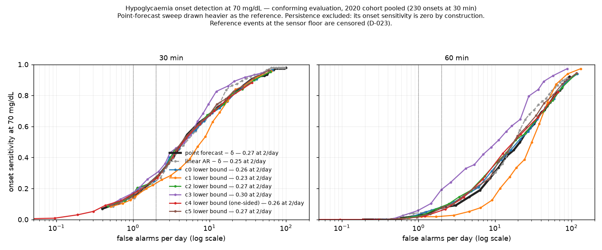
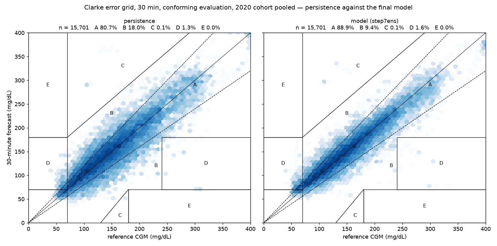

# cgm-forecast-conformal

Glucose forecasting at 30 and 60 minutes with calibrated conformal prediction intervals, evaluated by clinical error grids rather than RMSE alone.

**Result.** At two false alarms per day — a rate a person might tolerate — **a hypoglycaemia alarm built on this model detects 27% of onsets 30 minutes ahead, and that number belongs to the point forecast, not to any uncertainty method**: every conformal lower bound (c0–c5) is within the six-patient bootstrap interval of simply alarming when the point forecast drops below 70 + δ (c3 0.30 against the sweep's 0.27, +0.03 [-0.03, 0.09]). An hour ahead the picture changes: the point forecast detects 8% at that rate and **the adaptive conformal method (c3) detects 19% — +0.12 [0.02, 0.18] above the sweep, the one method to clear the rule logged before the curve was drawn** (D-064, D-065). That clears the rule as logged; it is **suggestive, not established**: one of six methods at one of two horizons, a bootstrap lower bound of 0.02, under a rule that made no allowance for twelve comparisons; the 54 mg/dL result (26% against 0) points the same way. The alarms that reach two false alarms per day sit at **25–30% nominal (60% for the one-sided c4)**, so the lower bound at that setting is an adaptive threshold, not the 90% interval reported elsewhere. At 54 mg/dL and 60 minutes the point forecast detects nothing and c3 26% of 39 censored events. The model is the frozen Week 4 sequence model (19.53 / 32.43 mg/dL RMSE at 30 / 60 minutes under the challenge's rules, fifth of nine in the official ranking); every interval is a post-hoc wrap around it, calibrated on a validation tail that early stopping had consumed and bracketed to show the cost (D-045). Nothing here is a claim about sensor accuracy: the reference is a CGM ([Limitations](#limitations-and-failure-cases)).



*The operating curve (D-065). Onset = a reading below 70 mg/dL whose forecast-origin reading was at or above it; persistence detects none by construction and is excluded. The heavy line is the control — alarm when the point forecast falls below 70 + δ — which any constant-width lower bound reduces to. Conformal lower bounds at nominal levels 5–95%. Vertical lines at 1 and 2 false alarms per day; the legend carries each curve's sensitivity at 2 per day. Conforming evaluation, 2020 cohort, 230 / 328 onsets. 54 mg/dL in [figures/operating_curve_54.png](figures/operating_curve_54.png), censored.*

**Three sentences the week established.** Pooled coverage is nominal for every method and breaks in both tails — c0 covers 0.668 above 250 mg/dL at 60 minutes, and in the 54–70 bin every miss of every method is below the bound — because the point forecast is shrunk toward the centre. The symmetric methods protect hypoglycaemic readings only by over-covering everywhere else (c0's lower side covers 0.962 in 70–180); the signed-residual method is tighter and loses the low bin (0.675 at 60 minutes); conditioning on the rate of change widens where residuals are large but not where the low readings are — **no residual-only score can move the interval's centre** (D-061–D-063). A 90% interval an hour ahead has a median width of 107 mg/dL and is wider than 100 in 65% of cases, and 85% of such intervals straddle the 70–180 boundary; the adaptive method narrows it to 85 at 31% useless and 67% straddling.



*Clarke error grid, 30-minute forecasts, conforming evaluation, 2020 cohort pooled (n = 15,701): persistence on the left, the final model on the right. The model moves 8.3 points of forecasts from zone B into zone A; zones A+B are 98.6% for persistence and 98.4% for the model — the grid barely separates them, which is why hypoglycaemia sensitivity is reported beside it. Parkes grid in [figures/parkes_final.png](figures/parkes_final.png).*

## The point forecast under it

**A sequence model with the same inputs as a linear autoregression does not beat it until it is trained on the full horizon, ensembled over history lengths and pre-trained on the other patients; those steps were worth 0.25, 0.25 and 0.34 mg/dL respectively at 30 minutes (conforming, 2020), the choice of family a further 0.12 and the ensemble of the final model 0.40, of which pre-training and both ensembles exceeded seed variability (0.15) and configuration selection (-0.01) and the family choice did not.** At 60 minutes the full-horizon loss alone was worth 1.36.

**And the model that wins on RMSE detects hypoglycaemia worst** (Week 4, D-039): sensitivity at 70 mg/dL an hour ahead is 0.012 for the final model against persistence's 0.353 — which is why Week 5 redefined the question as onset detection at a stated false-alarm rate (D-047) and drew the operating curve above.

**Per patient, conforming, with the fallback count beside the penalty** — does the model lose on 567 and 584 the way the linear AR did? Yes, by almost the same amount:

| Patient | n | Fallback 30 / 60 | Final, primary → conforming, 30 min | penalty | Final, primary → conforming, 60 min | Linear AR penalty, 30 min |
|---|---|---|---|---|---|---|
| 540 | 2,884 | 145 / 164 | 19.35 → **20.92** | +1.57 | 36.38 → 38.08 | +1.42 |
| 544 | 2,704 | 87 / 105 | 15.94 → **16.60** | +0.66 | 26.76 → 27.28 | +0.46 |
| 552 | 2,352 | 210 / 252 | 15.17 → **15.58** | +0.41 | 28.27 → 28.94 | +0.82 |
| 567 | 2,377 | 261 / 315 | 19.22 → **23.53** | +4.31 | 33.83 → 37.98 | +5.44 |
| 584 | 2,653 | 348 / 391 | 20.34 → **24.78** | +4.44 | 33.50 → 36.32 | +4.39 |
| 596 | 2,731 | 174 / 204 | 15.84 → **15.80** | -0.04 | 26.18 → 25.99 | +0.42 |

*Final model (7e). The linear AR's conforming penalties at 30 minutes were +5.44 (567) and +4.39 (584); the model's are +4.31 and +4.44. The primary-to-conforming gap for the model is 1.89 mg/dL at 30 minutes against the linear AR's 2.16: the cost of the outages is paid by every method alike. 596 is the one patient marginally easier under the conforming rule (-0.04); the cohort-level check that conforming is never easier passed.*

Full staircase, best-epoch audit, covariate ablation and the clinical scoring of the point forecast: [docs/sequence-model.md](docs/sequence-model.md).

## Operating points at one and two false alarms per day

| Method | h | At ≤ 1/day: setting · sensitivity · PPV | At ≤ 2/day: setting · sensitivity · PPV | Interpolated at 2/day, minus the sweep [bootstrap] | Verdict (D-064) |
|---|---|---|---|---|---|
| **point forecast − δ (reference)** | 30 | δ = 2 mg/dL · 0.109 · 0.42 | δ = 4 mg/dL · 0.170 · 0.39 | 0.266 | — |
| linear AR − δ | 30 | δ = 2 mg/dL · 0.113 · 0.41 | δ = 6 mg/dL · 0.196 · 0.38 | 0.245 (-0.021 [-0.08, 0.03]) | within variability |
| c0 split | 30 | level 0.20 · 0.157 · 0.41 | level 0.30 · 0.248 · 0.37 | 0.262 (-0.004 [-0.04, 0.04]) | within variability |
| c1 volatility-scaled | 30 | level 0.15 · 0.126 · 0.37 | level 0.30 · 0.222 · 0.35 | 0.233 (-0.033 [-0.11, 0.03]) | within variability |
| c2 Mondrian by forecast | 30 | level 0.20 · 0.152 · 0.41 | level 0.30 · 0.230 · 0.38 | 0.267 (+0.001 [-0.04, 0.04]) | within variability |
| **c3 adaptive** | 30 | level 0.15 · 0.170 · 0.43 | level 0.25 · 0.261 · 0.42 | 0.296 (+0.030 [-0.03, 0.09]) | within variability |
| c4 signed, one-sided | 30 | level 0.55 · 0.122 · 0.43 | level 0.60 · 0.183 · 0.41 | 0.260 (-0.006 [-0.04, 0.02]) | within variability |
| c5 Mondrian by rate | 30 | level 0.20 · 0.148 · 0.40 | level 0.30 · 0.243 · 0.38 | 0.271 (+0.005 [-0.06, 0.04]) | within variability |
| **point forecast − δ (reference)** | 60 | δ = 6 mg/dL · 0.015 · 0.11 | δ = 8 mg/dL · 0.037 · 0.15 | 0.076 | — |
| linear AR − δ | 60 | δ = 4 mg/dL · 0.040 · 0.22 | δ = 10 mg/dL · 0.064 · 0.19 | 0.069 (-0.007 [-0.11, 0.08]) | within variability |
| c0 split | 60 | level 0.20 · 0.015 · 0.11 | level 0.30 · 0.079 · 0.20 | 0.081 (+0.005 [-0.01, 0.04]) | within variability |
| c1 volatility-scaled | 60 | level 0.15 · 0.012 · 0.09 | level 0.25 · 0.018 · 0.06 | 0.021 (-0.055 [-0.10, -0.01]) | below the sweep |
| c2 Mondrian by forecast | 60 | level 0.20 · 0.012 · 0.10 | level 0.30 · 0.067 · 0.20 | 0.080 (+0.005 [-0.01, 0.03]) | within variability |
| **c3 adaptive** | 60 | level 0.15 · 0.058 · 0.27 | level 0.25 · 0.192 · 0.38 | 0.193 (+0.117 [0.02, 0.18]) | above the sweep |
| c4 signed, one-sided | 60 | level 0.55 · 0.003 · 0.03 | level 0.60 · 0.021 · 0.10 | 0.056 (-0.020 [-0.04, 0.02]) | within variability |
| c5 Mondrian by rate | 60 | level 0.20 · 0.015 · 0.09 | level 0.25 · 0.037 · 0.14 | 0.075 (-0.001 [-0.05, 0.02]) | within variability |

*`results/operating_points.csv`, `results/operating_curve_claim.csv`; 70 mg/dL, conforming, 2020 pooled. "Setting" is the last point on each curve at or below the rate (the grid is discrete). The interpolated column is what the claim rule reads. Specificity exceeds 0.99 for every method at these rates. The regulation's (b)(7)(iv) quartet reads off these rows: true alert rate = sensitivity, missed = 1 − sensitivity, false alert rate = false alarms per day, correct alert rate = PPV. Per patient and at 54 mg/dL: [docs/intervals.md](docs/intervals.md).*

## Against the published ranking

| Conforming evaluation, 2020 cohort, mean of six | Inputs | RMSE 30 | MAE 30 | RMSE 60 | MAE 60 | Four-score | Position |
|---|---|---|---|---|---|---|---|
| **this repository — final sequence model** | CGM + insulin + meals | **19.53** | 13.42 | **32.43** | 23.57 | **88.96** | 5 of 9 |
| this repository — linear AR (per-patient, H=24, +cov) | CGM + insulin + meals | 20.77 | 14.79 | 34.12 | 25.71 | 95.41 | — |
| this repository — persistence | CGM only | 25.48 | 18.06 | 41.42 | 30.43 | 115.39 | — |
| Rubin-Falcone (p18), residual LSTM — *partial: external pre-training, extra inputs* | CGM + insulin + meals + finger-stick + time | 18.22 | 12.83 | 31.66 | 23.60 | 86.31 | 1 |
| Hameed (p14), vanilla RNN | CGM only | 19.21 | 13.08 | 31.77 | 23.09 | 87.15 | 2 |
| Zhu (p15), GRU-GAN | CGM + insulin + meals | 18.34 | 13.37 | 32.21 | 24.20 | 88.12 | 3 |
| Yang (p24), multi-scale LSTM | CGM + insulin + meals | 19.05 | 13.50 | 32.03 | 23.83 | 88.41 | 4 |
| Bevan (p17), population LSTM | CGM only | 18.23 | 14.37 | 31.10 | 25.75 | 89.45 | 5 |

*Position is the official 2020 rank among the eight conforming systems; this repository's four-score sum would place it fifth, moving Bevan to sixth. Three of eight officially ranked systems used inputs matching ours; two match CGM-only; three are online or wearable-based and shown for context. Figures transcribed from the official results page and the system papers, never from memory ([docs/published_comparison.md](docs/published_comparison.md)); Rubin-Falcone is a partial match and not used as a comparator. Our primary-protocol figures (18.61 / 32.37 for the linear AR on the same cohort) are not placed here: they drop post-outage targets the challenge scores ([docs/evaluation-variants.md](docs/evaluation-variants.md)).*

## Method

Per patient, the family that won on validation — a one-layer GRU or LSTM (hidden 64–256) or a small dilated causal CNN — over H history steps of CGM, basal, bolus and carbohydrates, predicting the change from the last reading with a zero-initialised head so that the untrained model is persistence; trained on the full horizon where that won on validation; pre-trained on the twelve training files and the 2018 test files, fine-tuned per patient with early stopping on the frozen validation tail; median over six history lengths. Five seeds per configuration. Frozen at commit `75e0817` for Week 5's conformal intervals. Error grids, MARD, time-in-range agreement and hypoglycaemia sensitivity from the scorer frozen before the model (D-022–024).

## Reproduce

```bash
python -m venv .venv && source .venv/bin/activate
pip install -r requirements.txt
pre-commit install && pre-commit install --hook-type pre-push   # secrets at commit; guard and data-free tests at push
# obtain OhioT1DM first: see data/README.md
pytest                              # 395 tests; 209 need the dataset and skip without it
python -m src.data.gap_analysis     # results/gap_analysis.csv
python -m src.data.effective_n      # results/effective_n.csv and window_reconciliation.csv (~3 min first run)
python -m src.eval.baselines        # baselines under both variants: results/baselines*.csv and baselines_challenge_scores.csv (~6 min)
python -m src.eval.clinical_baselines  # results/clinical_baselines.csv and the two error-grid figures
python -m src.staircase step1       # then step2 … step7: the sequence model, ~23 h on an M4 (rows to the cache; snapshot in results/)
python -m src.eval.staircase_eval   # results/sequence_*.csv, both variants, every step
python -m src.eval.clinical_model   # results/clinical_final.csv, figures/hero_clarke.png, figures/parkes_final.png
python -m src.eval.best_epochs      # results/best_epochs.csv, figures/best_epochs.png
python -m src.staircase regen       # regenerate the 144 frozen ensemble members, asserting identity, for calibration (~1 h)
python -m src.eval.coverage         # results/coverage.csv, onset_first_pass.csv, the coverage and width figures
python -m src.eval.coverage_breakdown  # results/coverage_breakdown.csv, width_vs_error.csv, c3_recovery.csv and their figures
python -m src.eval.icgm_analogue    # results/icgm_analogues.csv — forecast analogues of 21 CFR 862.1355(b), thresholds parsed from docs/icgm_criteria.md
python -m src.eval.c4_lower         # results/c4_hypoglycaemic_bins.csv — the one-sided bound against c0, c3 and c5 below 70
python -m src.eval.operating_curve  # results/operating_curve.csv, operating_curve_claim.csv, operating_points.csv and the hero figure (~15 min)
python -m src.eval.interval_clinical  # results/interval_clinical.csv — zones, MARD, straddle rate and the onset table for the intervals
```

Data: see [data/README.md](data/README.md). No data is included in this repository.

## Limitations and failure cases

Known before any model was fitted. Horizon-dependent coverage failures, hypoglycaemia misses and per-patient variation are added once results exist.

- **The reference is a CGM, not a laboratory measurement.** Ground truth here is a Medtronic Enlite sensor, so every result — this repository's and every published figure on OhioT1DM — measures agreement with a device that itself differs from the patient's true blood glucose. A forecast matching the CGM exactly would still be wrong by the sensor's own error against a laboratory assay. The Enlite was an **adjunctive** device, not cleared for treatment decisions without a confirmatory fingerstick; that is specific to this sensor and era, and current CGMs (Dexcom G6/G7, FreeStyle Libre 2/3) carry non-adjunctive labelling under the iCGM special controls at 21 CFR 862.1355. Results here are described as agreement with the CGM reference, never as accuracy against blood glucose.
- **Readings at the sensor floor are censored, and the bias lands where it matters most.** CGM values are clipped to [40, 400] mg/dL. Both hypoglycaemia thresholds (70 and 54) sit inside that range and can be evaluated; what cannot be measured is error *below* 40, where a true 30 is reported as 40 and a forecast of 40 scores as exact while being 10 mg/dL high. 206 readings (0.124%) sit exactly at the floor — but **17.8% of all readings below 54 mg/dL do**, so low-end error-grid zones and any metric on floored readings are biased optimistic in the severe-hypoglycaemia region.
- **Per-patient figures are not comparable without their target counts.** 552's test split is 40.2% missing with a 118-hour gap, so its error rests on far fewer evaluable targets than any other patient's. Every per-patient number is reported with its effective n.
- **Wearable channels are not uniformly available**, so they are restricted to a secondary stratified analysis: heart rate is empty for five 2020 patients and absent for 596, and acceleration exists only in the 2020 cohort. Primary models use CGM, insulin and meals only — the channels all 12 patients have and the published comparisons use.
- **No conformal method moves the interval's centre, and training with a quantile or asymmetric loss — the route the post-hoc results point to — was not done.** Conformalised quantile regression was excluded because the model is a frozen point forecaster; a model trained with a pinball or asymmetric loss would produce the lower quantile directly. Logged as the next step, not taken (D-069).
- **Every bootstrap is over six patients.** The intervals around the operating-curve differences are wide (c3 at 60 minutes: +0.12 [0.02, 0.18]); per patient, c3 is above the sweep on three of six at 30 minutes and below on two.
- **The iCGM analogues are analogues** — sensor criteria applied to forecast-versus-CGM agreement — and the Wilson bounds in them are optimistic under serial correlation.
- **The conformal calibration set was consumed by early stopping**, and the model is frozen, so no clean split exists; the consequence is measured (bracket beside every number) rather than removed. Conformalised quantile regression is excluded because the model is a point forecaster.
- **A 90% interval an hour ahead is mostly too wide to act on** (107 mg/dL median, 65% over 100), and the adaptive method's narrower intervals come with infinite ones after outages. The 90% lower bound is not a hypoglycaemia alarm at any usable false-alarm rate on this first pass.
- **Two patient sets fail split-conformal coverage by more than five points** (596 at 30 min, 540 at 60) — an exchangeability failure that the online method repairs and the others do not.
- **The sequence-model search was a coordinate search, not a grid.** Each axis (H → hidden → cell → layers → dropout → lr) was tuned conditional on the axes already chosen, so interactions between axes — hidden size with history length, say — are invisible to it; a configuration that is only good in combination was never visited (D-033).
- **The model that wins on RMSE is the worst at detecting hypoglycaemia.** Sensitivity at 70 mg/dL an hour ahead is 1.2% for the final model against 35.3% for persistence; at 54 mg/dL it detects nothing. A squared-error forecaster of the conditional mean is not a hypoglycaemia alarm, and the README's headline number should be read with that beside it.
- **"Fine-tuned per patient" means one epoch of adaptation.** The fine-tunes stopped at epoch 1 in most fits and the harness never offered zero epochs, so the final model is a population model that has seen the patient's own training file, with one epoch of adaptation — comparable to Bevan's scheme, not Rubin-Falcone's.
- **Per-patient early stopping is unreliable for 570 and 591**, whose validation tails rise from the first epoch; the split is frozen and was not changed.
- **No external data, and narrower inputs than the published best.** Rubin-Falcone pre-trained on ~15M external steps and used finger-stick and time-of-day inputs; this repository used neither, by rule.
- **12 patients, one sensor, one pump family, eight weeks each.** Nothing here supports a claim about other devices or populations.

## More detail

- [docs/data-layer.md](docs/data-layer.md) — the loader, the gap analysis, the windows and the effective-n table
- [docs/baselines.md](docs/baselines.md) — persistence, linear extrapolation and the linear AR, with their clinical metrics
- [docs/evaluation-variants.md](docs/evaluation-variants.md) — the primary protocol beside the challenge-conforming variant, with the cost per patient
- [docs/sequence-model.md](docs/sequence-model.md) — the staircase, the best-epoch audit, the covariate ablation, the point forecast's clinical scoring
- [docs/intervals.md](docs/intervals.md) — calibration, first-pass coverage, the c4 one-sided bound, the interval clinical tables
- [docs/where-coverage-breaks.md](docs/where-coverage-breaks.md) — coverage by glucose bin, rate of change and time since outage; width against error; the iCGM analogues
- [docs/published_comparison.md](docs/published_comparison.md) — the eight ranked systems, their inputs, and which qualify
- [docs/icgm_criteria.md](docs/icgm_criteria.md) — 21 CFR 862.1355(b) as transcribed, and why everything here is an analogue
- [docs/protocol.md](docs/protocol.md) — the evaluation protocol, frozen before any model was fitted
- [docs/decisions.md](docs/decisions.md) — every design decision, its evidence, what was rejected, and the open items
- [docs/NEXT.md](docs/NEXT.md) — the one question the repository resumes on in January 2027

## References

- Marling, C., & Bunescu, R. (2020). The OhioT1DM dataset for blood glucose level prediction: Update 2020. *CEUR Workshop Proceedings*, 2675, 71–74.
- Clarke, W. L., et al. (1987). Evaluating clinical accuracy of systems for self-monitoring of blood glucose. *Diabetes Care*, 10(5), 622–628.
- Parkes, J. L., et al. (2000). A new consensus error grid to evaluate the clinical significance of inaccuracies in the measurement of blood glucose. *Diabetes Care*, 23(8), 1143–1148.

## Licence

MIT
